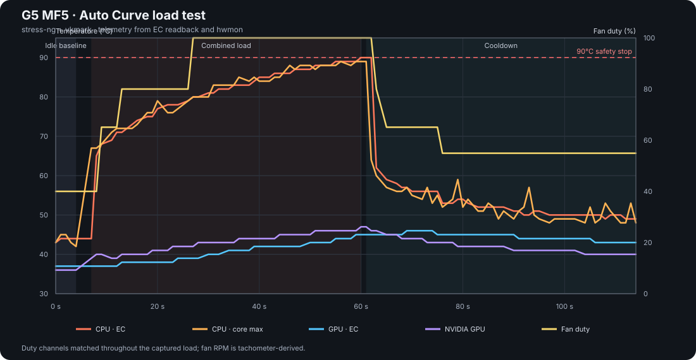
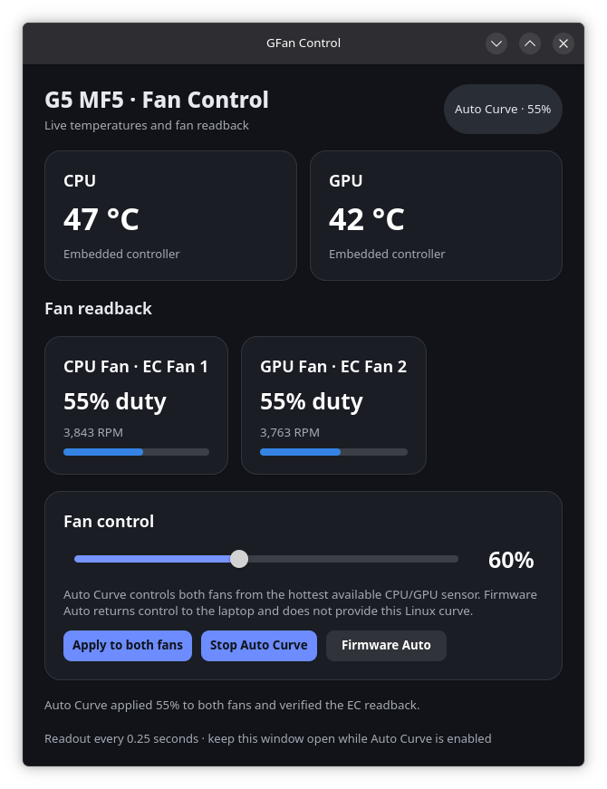

# Auto Curve load test — 2026-10-16

This capture records a supervised combined CPU and NVIDIA GPU load on one GIGABYTE G5 MF5 running Bazzite. The Auto Curve was enabled before the run; the opening desktop capture shows it active at 40%. The test did not change the fan setting directly. A safety guard stopped both workloads when the embedded-controller CPU reading reached 90°C, then telemetry continued through cooldown.

## Result

The curve followed the configured fan steps as the CPU warmed: both fans read 40% at idle, 65% at 68°C, 80% at 71°C, and 100% at 80°C. The 55% point was crossed between samples during the rapid warm-up, so it was not separately captured under load. At 100%, tachometer readback peaked at approximately 5,765 RPM on channel 1 and 5,629 RPM on channel 2.

The combined load reached the capture's 90°C cutoff after about 54 seconds. At that point the embedded-controller CPU reading was 90°C and the maximum CPU core reading was 89°C; both fans were already at 100%. This confirms the curve ramped to its top step, while also showing that the test workload continued to heat the CPU at full fan. The run was stopped by the capture guard, not by a stress-ng failure. During the 45-second cooldown, CPU temperature fell to 49°C and the curve reduced both fans to 55%.

| Measurement | Captured result |
| --- | ---: |
| Highest CPU temperature, EC sensor | 90°C (safety cutoff) |
| Highest CPU core temperature | 89°C |
| Highest GPU temperature, NVIDIA sensor | 47°C |
| Highest GPU temperature, EC sensor | 45°C under load |
| Peak NVIDIA utilization | 38% |
| Peak fan duty | 100% on both channels |
| Peak fan tachometer readback | 5,765 / 5,629 RPM |
| Lowest available system memory | 9,219 MiB |
| stress-ng | 18 workers passed: 16 CPU, 2 VM; 0 failed; 55.30 seconds |
| vkmark | Score 162; NVIDIA GPU selected |

The log contains 91 samples: 5 baseline, 41 combined-load, and 45 cooldown samples. The sampler targets a one-second interval, but synchronous read commands and load caused drift: the combined-load phase averaged 1.33 seconds between samples, with a 2-second maximum gap (3 seconds across a phase boundary). The chart uses the recorded timestamps. The GUI's displayed readout interval is 250 ms, as shown in the captures.

## Method

The capture script ran `stress-ng --cpu 0 --cpu-load 100 --vm 2 --vm-bytes 35% --timeout 60s --metrics-brief` alongside `vkmark` in an 800×600 Wayland window on the NVIDIA GPU. It sampled `sudo gfan status`, maximum `coretemp`, NVIDIA temperature/utilization, and available memory. The script does not issue fan commands. It terminates the load at 90°C, after eight consecutive samples below the curve's expected duty, or below 1 GiB available memory. The 90°C guard ended this run before the configured 60-second timeout. `stress-ng` reported 55.30 seconds and 18 passing workers; vkmark recorded a score of 162.

The first recorded loaded samples were at 40% while the EC CPU reading rose quickly through 65°C, then 65% at 68°C. The next curve transitions were captured at 80%/71°C and 100%/80°C. This was a high-load transient rather than a thermal-equilibrium test; the 90°C stop means the current curve should be reviewed for additional margin under sustained all-core load. No threshold was changed as part of this measurement.

## Files

- [`readings.csv`](readings.csv): timestamped temperature, duty, RPM, GPU utilization, and memory samples.
- [`benchmark-results.txt`](benchmark-results.txt): sanitized stress-ng and vkmark summaries.
- [`capture-load-test.sh`](capture-load-test.sh): bounded capture procedure for the active Bazzite desktop session.
- [`plot_readings.py`](plot_readings.py): dependency-free SVG chart generator.
- GUI captures: before the run and after cooldown.

This is evidence from one laptop and one run. EC fan duty is a command readback, RPM is tachometer-derived, and the physical CPU/GPU assignment of the two fan channels has not been independently verified. The capture does not establish behavior after reboot, suspend/resume, kernel updates, or on other G5 variants.
